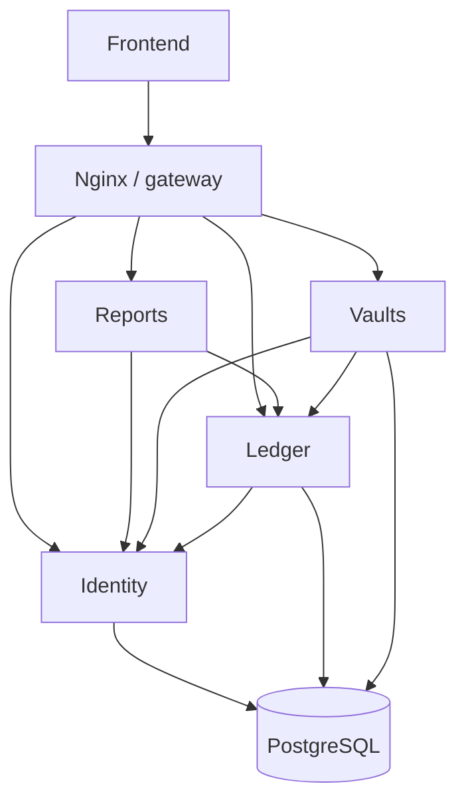

# Arquitectura de SmartVault Bank — Java 21

Versión de demostración: cuatro microservicios de negocio. No hay servicio de correo ni colas asociadas.

## Dependencias y responsabilidades

| Servicio | Puerto local interno | Responsabilidad |
|---|---:|---|
| Identity | 8081 | Registro, login, credenciales BCrypt, sesiones HMAC, bloqueo y revocación |
| Ledger | 8082 | Billeteras, asientos dobles, idempotencia, integridad, referencias externas |
| Vaults | 8083 | Bóvedas, aportes, propuestas, quórum, hitos, desembolsos y auditoría |
| Reports | 8084 | Lectura y análisis de últimos 100 movimientos: resumen, ingresos, egresos, aportes, detalle, CSV |

Cada servicio tiene sus paquetes `domain`, `application`, `infrastructure` y `config`.

- Dominio: reglas de negocio y modelos independientes de Spring/JPA.
- Aplicación: casos de uso y puertos; no accede directamente a HTTP ni a base de datos.
- Infraestructura: controladores, repositorios, clientes HTTP y exportación CSV.
- Configuración: creación e inyección de implementaciones.

Reports depende de su `MovementPort`; `LedgerMovementAdapter` implementa ese puerto. El controlador verifica el token mediante Identity y obtiene únicamente el ID del titular, que entrega al caso de uso. Ledger verifica la clave interna y filtra por billetera. Reports no consulta ni modifica tablas ajenas y no necesita base de datos propia. El código de Reports no importa módulos de negocio de los otros servicios.

`platform` centraliza la firma HMAC, guardas de seguridad, configuración de Neon y mapeo de errores. El token firmado conserva el formato original (no es un JWT estándar). Identity, Ledger y Vaults conservan el PostgreSQL compartido con prefijos por responsabilidad; no es una base físicamente independiente por servicio. El cambio no transforma el monolito de datos en cuatro bases.

Las operaciones financieras, quórum, votos, hitos, idempotencia y auditoría se conservan. Se eliminó el acoplamiento de Ledger y Vaults a colas de correo. Se añadieron dos índices de lectura sobre las columnas `source` y `target` del libro mayor.

## Limitaciones

Proyecto académico de dinero simulado. El registro directo no demuestra la propiedad de una dirección de correo: usar solo con participantes de confianza y en entorno controlado. No se recomienda publicar el registro sin un mecanismo real de verificación. El esquema anterior usa Hibernate `ddl-auto: update`; no se implementó Flyway ni transacciones distribuidas. Los reportes cubren solo 100 movimientos, no el historial vitalicio. No se alteró el diseño de operaciones externas ni se garantiza una latencia de 500 ms sin mediciones reales.
